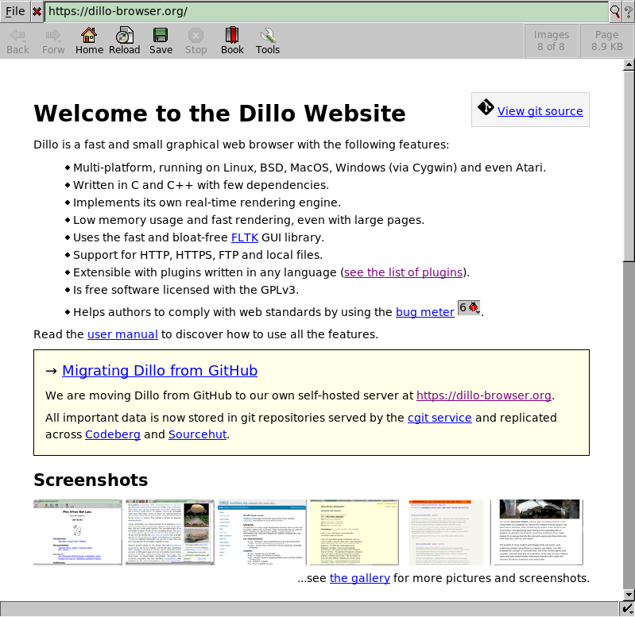

# what is this repo
Official dillo site: https://dillo-browser.org/

Cloned from original https://github.com/dillo-browser/dillo, detached, 
and applied patches from https://walley.org/dillo/ (26/11/10).
AI continued working on this fork.
Renamed to **vibedillo**.

See [ChangeLog](ChangeLog) for detailed changes.

# vibedillo web browser

vibedillo is a multi-platform graphical web browser, known for its speed and
small footprint, that is developed with a focus on personal security and
privacy. It is built with the [FLTK 1.3 GUI toolkit](http://fltk.org).

Screenshot of the [vibedillo Website][vibedillo] rendered in vibedillo:

[vibedillo]: https://walley.org/

To install vibedillo follow the [installation guide](doc/install.md).

You can clone the latest version of vibedillo directly from our git server:

- <https://github.com/walley/vibedillo>

The commits are signed with the same OpenPGP we use for the releases.

See also other related forks: [dillo-plus][dillo-plus],
[dilloNG][dilloNG], [D+ browser][dplus-browser] and [Mobilized
Dillo][mobilized].

[dillo-plus]: https://github.com/crossbowerbt/dillo-plus
[dilloNG]: https://github.com/w00fpack/dilloNG
[dplus-browser]: https://sourceforge.net/projects/dplus-browser/
[mobilized]: https://www.toomanyatoms.com/software/mobilized_dillo.html

> **Warning**:
> As of December 2023, the host `dillo.org` is [no longer under control][gone]
> of Dillo developers. A copy of the old website is archived in
> [our website][old] and the [Wayback Machine (May 2022)][may].

[gone]: https://walley.org/dillo.org.html
[old]: https://walley.org/old/
[may]: http://web.archive.org/web/20220508022123/https://www.dillo.org/

